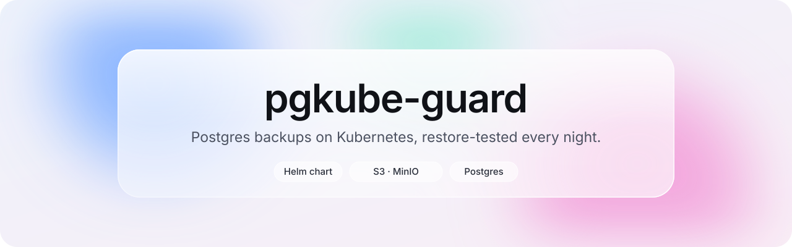

<p align="center">
  <picture>
    <source media="(prefers-color-scheme: dark)" srcset="docs/assets/banner-dark.svg">
    
  </picture>
</p>

<p align="center">
  <b>Everyone backs up their database. Almost nobody tests the restore.</b><br>
  pgkube-guard does both, every night, and tells you the moment something breaks.
</p>

<p align="center">
  <a href="#get-started">Get started</a> &nbsp;·&nbsp;
  <a href="#how-it-works">How it works</a> &nbsp;·&nbsp;
  <a href="#configuration">Configuration</a> &nbsp;·&nbsp;
  <a href="#troubleshooting">Troubleshooting</a>
</p>

<br>

## How it works

pgkube-guard is a Helm chart. You describe your setup in a single `values.yaml`, it installs two nightly CronJobs, and Kubernetes takes it from there.

```text
  02:00   Backup
          ├─ pg_dump your database            (read-only user)
          ├─ upload the dump to S3            (write credentials)    
          └─ keep the last N dumps, notify on failure

  04:00   Restore test
          ├─ download the latest dump         (read-only credentials)
          ├─ restore it into a throwaway Postgres, inside the pod
          ├─ run your check query             e.g. SELECT COUNT(*) FROM users
          └─ notify on failure, then vanish
```

The restore test never receives your database credentials. It cannot reach production, even by mistake.

<br>

## Get started

**What you need**

- A Kubernetes cluster (1.27+) with `kubectl` and `helm`
- A Postgres reachable from that cluster: in-cluster, AWS RDS, Cloud SQL or a plain VM
- An S3 bucket, or any S3-compatible storage such as MinIO

**1 · Create a read-only database user**

pgkube-guard only reads your data. Give it nothing more.

```sql
CREATE ROLE backup_user LOGIN PASSWORD 'change-me';
GRANT pg_read_all_data TO backup_user;   -- Postgres 14+
```

**2 · Prepare two sets of S3 credentials**

One that can write (for backups), one that can only read (for restore tests). If the restore test is ever compromised, your backups stay safe.

<details>
<summary>Minimal IAM policies for AWS</summary>
<br>

Backup user, write access limited to the `pgkube-guard/` prefix:

```json
{
  "Version": "2012-10-17",
  "Statement": [
    {
      "Effect": "Allow",
      "Action": "s3:ListBucket",
      "Resource": "arn:aws:s3:::my-backups",
      "Condition": { "StringLike": { "s3:prefix": "pgkube-guard/*" } }
    },
    {
      "Effect": "Allow",
      "Action": ["s3:PutObject", "s3:DeleteObject", "s3:AbortMultipartUpload"],
      "Resource": "arn:aws:s3:::my-backups/pgkube-guard/*"
    }
  ]
}
```

Restore user, read-only:

```json
{
  "Version": "2012-10-17",
  "Statement": [
    {
      "Effect": "Allow",
      "Action": "s3:ListBucket",
      "Resource": "arn:aws:s3:::my-backups",
      "Condition": { "StringLike": { "s3:prefix": "pgkube-guard/*" } }
    },
    {
      "Effect": "Allow",
      "Action": "s3:GetObject",
      "Resource": "arn:aws:s3:::my-backups/pgkube-guard/*"
    }
  ]
}
```

</details>

**3 · Store your credentials as Kubernetes Secrets**

Your passwords never go through this repository or your values file.

```bash
kubectl create namespace pgkube-guard

kubectl create secret generic postgres-credentials -n pgkube-guard \
  --from-literal=username=backup_user \
  --from-literal=password='change-me'

kubectl create secret generic s3-backup-credentials -n pgkube-guard \
  --from-literal=AWS_ACCESS_KEY_ID='...' \
  --from-literal=AWS_SECRET_ACCESS_KEY='...'

kubectl create secret generic s3-restore-credentials -n pgkube-guard \
  --from-literal=AWS_ACCESS_KEY_ID='...' \
  --from-literal=AWS_SECRET_ACCESS_KEY='...'
```

**4 · Describe your setup**

```bash
helm repo add pgkube-guard https://elyas-gitspace.github.io/pgkube-guard
helm repo update
curl -sSLo my-values.yaml https://raw.githubusercontent.com/elyas-gitspace/pgkube-guard/main/examples/values.example.yaml
```

Open `my-values.yaml` and point it to your database, your bucket and the Secrets you just created:

```yaml
postgres:
  host: postgres.my-app.svc.cluster.local
  database: mydb
  existingSecret: postgres-credentials

storage:
  s3:
    bucket: my-backups
    region: eu-west-3
    backupCredentials:
      existingSecret: s3-backup-credentials
    restoreCredentials:
      existingSecret: s3-restore-credentials

restoreTest:
  checkQuery: "SELECT COUNT(*) FROM users"
```

**5 · Install**

```bash
helm install my-backup pgkube-guard/pgkube-guard -n pgkube-guard -f my-values.yaml
```

**6 · Don't wait for tonight**

Trigger both jobs now and watch them succeed.

```bash
kubectl create job --from=cronjob/my-backup-pgkube-guard-backup first-backup -n pgkube-guard
kubectl logs -n pgkube-guard job/first-backup --all-containers -f

kubectl create job --from=cronjob/my-backup-pgkube-guard-restore-test first-restore -n pgkube-guard
kubectl logs -n pgkube-guard job/first-restore --all-containers -f
```

You should see `Backup OK`, then `Restore test mydb OK … restored in Xs`. From now on, it runs every night on its own.

<br>

## Where is your Postgres?

pgkube-guard only needs a host it can reach. The chart is the same everywhere, only two settings change.

| Your database | `postgres.host` | `postgres.sslMode` | Network |
|---|---|---|---|
| In the same cluster | `<service>.<namespace>.svc.cluster.local` | `prefer` | Nothing to do, unless a NetworkPolicy blocks it |
| AWS RDS | the RDS endpoint | `require` | Allow port 5432 from the cluster in the RDS security group |
| Google Cloud SQL | the instance IP | `require` | Authorize the cluster network on the instance |
| A virtual machine | the VM IP | `prefer` or `require` | Open 5432 in the firewall and allow the cluster in `pg_hba.conf` |

<br>

## Configuration

Everything lives in [`values.yaml`](charts/pgkube-guard/values.yaml), with comments next to each setting. The ones you will actually touch:

| Key | Default | What it does |
|---|---|---|
| `postgres.host` | | Database address (required) |
| `postgres.database` | | Database to back up (required) |
| `postgres.existingSecret` | | Secret holding the username and password |
| `postgres.secretKeys` | `username` / `password` | Key names inside that Secret, if yours differ |
| `postgres.sslMode` | `prefer` | Use `require` for managed databases |
| `storage.s3.bucket` | | Destination bucket (required) |
| `storage.s3.prefix` | `pgkube-guard/` | Folder inside the bucket |
| `storage.s3.endpoint` | | Set it for MinIO or any S3-compatible storage |
| `backup.schedule` | `0 2 * * *` | When to back up |
| `backup.timeZone` | `Etc/UTC` | Time zone of both schedules, e.g. `Europe/Paris` |
| `backup.retention` | `7` | How many dumps to keep |
| `restoreTest.enabled` | `true` | Turn the nightly restore test on or off |
| `restoreTest.checkQuery` | any table exists | Must return a number greater than 0 |
| `images.postgres.tag` | `17-alpine` | Must be at least your server's major version |

Prefer not to create Secrets yourself? Leave `existingSecret` empty and set `postgres.username`, `postgres.password` or `accessKeyId`, `secretAccessKey` inline. The chart creates the Secrets for you. Fine for a test, not recommended for production.

<br>

## Notifications

Silence is the worst failure mode: if the CronJob never runs, nothing ever reports an error. pgkube-guard gives you two ways to hear about it.

```yaml
notifications:
  slackWebhookUrl: https://hooks.slack.com/services/...   # a message when something fails
  notifyOnSuccess: false                                   # set to true for a daily "all good"
  healthcheck:
    backupUrl: https://hc-ping.com/<uuid>                  # alerts you if no ping arrives
    restoreUrl: https://hc-ping.com/<uuid>
```

A heartbeat service such as [healthchecks.io](https://healthchecks.io) expects a ping every night. If it doesn't get one, because the job crashed, never started or the cluster is down, it alerts you. This is the only way to catch a backup that silently stopped running.

<br>

## Security by design

- **Read-only database access.** The backup user can read your data, never change it.
- **Production stays out of reach.** The restore test has no database credentials at all.
- **Split S3 permissions.** Write for backups, read for restore tests, each limited to one prefix.
- **Hardened pods.** Non-root, no privilege escalation, all Linux capabilities dropped, `RuntimeDefault` seccomp.
- **No Kubernetes API access.** Pods run with a dedicated ServiceAccount and no mounted token.

<br>

## Day-to-day

```bash
helm upgrade my-backup pgkube-guard/pgkube-guard -n pgkube-guard -f my-values.yaml   # apply new settings
helm rollback my-backup 1 -n pgkube-guard                                            # go back to a previous version
helm uninstall my-backup -n pgkube-guard                                             # remove everything
```

Your dumps stay in your bucket after an uninstall. pgkube-guard never deletes data it did not create.

<br>

## Troubleshooting

<details>
<summary><code>pg_dump</code> hangs, then times out</summary>
<br>
The pod cannot reach your database. Check the security group, firewall or NetworkPolicy between the cluster and Postgres on port 5432.
</details>

<details>
<summary><code>server does not support SSL</code></summary>
<br>
Your Postgres has TLS disabled, which is common in-cluster. Set <code>postgres.sslMode: prefer</code>.
</details>

<details>
<summary><code>aborting because of server version mismatch</code></summary>
<br>
<code>pg_dump</code> must be at least as recent as your server. Set <code>images.postgres.tag</code> to your major version, e.g. <code>18-alpine</code>.
</details>

<details>
<summary><code>no dump found</code> during the restore test</summary>
<br>
No backup has succeeded yet, or the prefix differs. Run a backup first and check <code>storage.s3.prefix</code>.
</details>

<details>
<summary><code>check query returned '0'</code></summary>
<br>
The dump restored fine but the table is empty, or the query targets the wrong table. Adjust <code>restoreTest.checkQuery</code>.
</details>

<br>

## Roadmap

- [x] Nightly backup and restore test
- [x] Helm chart
- [x] Published Helm repository
- [ ] ArtifactHub listing
- [ ] Built-in Prometheus metrics
- [ ] Operator with a `PostgresBackup` custom resource

<br>

<p align="center">
  <sub>Built to make sure your backups actually work.</sub>
</p>
