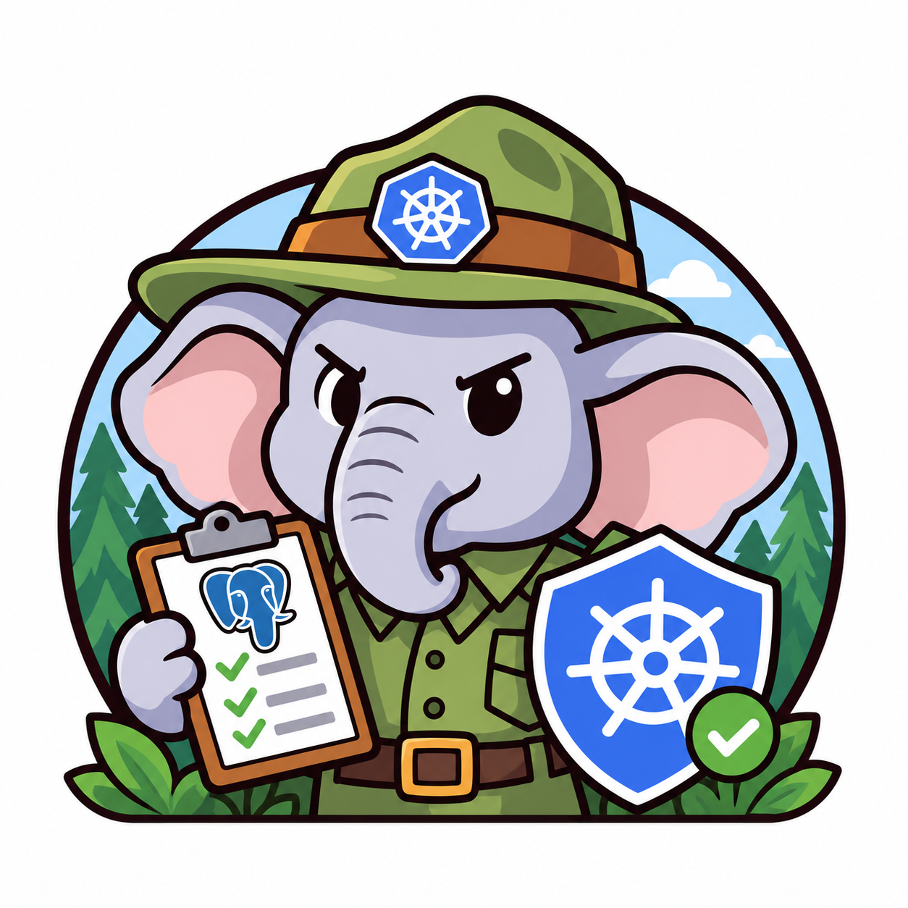

<p align="center">
  
</p>

<h1 align="center">pgkube-guard</h1>

<p align="center">
  <b>Everyone backs up their database. Almost nobody tests the restore.</b><br>
  pgkube-guard proves your Postgres backups actually restore, measures how long it takes and how much data you would lose, and tells you the moment something breaks.
</p>

<p align="center">
  <a href="#get-started">Get started</a> &nbsp;·&nbsp;
  <a href="#how-it-works">How it works</a> &nbsp;·&nbsp;
  <a href="#configuration">Configuration</a> &nbsp;·&nbsp;
  <a href="#troubleshooting">Troubleshooting</a>
</p>

<br>

## How it works

pgkube-guard is a Helm chart. You describe your setup in a single `values.yaml`, it installs a few CronJobs, and Kubernetes takes it from there.

It works with the backups you already have, or makes them for you:

| Your backups come from | `verify.source` | `backup.enabled` |
|---|---|---|
| Nothing yet: let pgkube-guard run `pg_dump` | `pgdump` | `true` |
| [wal-g](https://github.com/wal-g/wal-g) (base backups + continuous WAL archiving) | `walg` | `false` |

```text
  02:00   Backup                              (optional, pg_dump mode only)
          ├─ pg_dump your database            (read-only user)
          └─ upload the dump to S3, keep the last N

  hourly  Freshness check                     (cheap: only lists the bucket)
          ├─ pg_dump: is the last dump recent enough?
          └─ wal-g:   is the last base backup recent? is WAL archiving still running?

  weekly  Restore drill                       (the real proof)
          ├─ restore the latest backup into a throwaway Postgres, inside the pod
          │    pg_dump: pg_restore the latest dump
          │    wal-g:   fetch the latest base backup, then replay every archived WAL
          ├─ run your check query             e.g. SELECT COUNT(*) FROM users
          ├─ measure RTO                      how long the restore took
          ├─ measure RPO                      how old the restored data is
          └─ notify, push metrics, then vanish
```

Verification jobs never receive your database credentials and only get read-only S3 access. They cannot reach production, even by mistake.

<br>

## Get started

**What you need**

- A Kubernetes cluster (1.27+) with `kubectl` and `helm`
- A Postgres reachable from that cluster: in-cluster, AWS RDS, Cloud SQL or a plain VM
- An S3 bucket, or any S3-compatible storage such as MinIO

**1 · Create a read-only database user**

pgkube-guard only reads your data. Give it nothing more.

```sql
CREATE ROLE backup_user LOGIN PASSWORD 'change-me';
GRANT pg_read_all_data TO backup_user;   -- Postgres 14+
```

**2 · Prepare two sets of S3 credentials**

One that can write (for backups), one that can only read (for verification). If a verification job is ever compromised, your backups stay safe.

<details>
<summary>Minimal IAM policies for AWS</summary>
<br>

Backup user, write access limited to the `pgkube-guard/` prefix:

```json
{
  "Version": "2012-10-17",
  "Statement": [
    {
      "Effect": "Allow",
      "Action": "s3:ListBucket",
      "Resource": "arn:aws:s3:::my-backups",
      "Condition": { "StringLike": { "s3:prefix": "pgkube-guard/*" } }
    },
    {
      "Effect": "Allow",
      "Action": ["s3:PutObject", "s3:DeleteObject", "s3:AbortMultipartUpload"],
      "Resource": "arn:aws:s3:::my-backups/pgkube-guard/*"
    }
  ]
}
```

Verify user, read-only:

```json
{
  "Version": "2012-10-17",
  "Statement": [
    {
      "Effect": "Allow",
      "Action": "s3:ListBucket",
      "Resource": "arn:aws:s3:::my-backups",
      "Condition": { "StringLike": { "s3:prefix": "pgkube-guard/*" } }
    },
    {
      "Effect": "Allow",
      "Action": "s3:GetObject",
      "Resource": "arn:aws:s3:::my-backups/pgkube-guard/*"
    }
  ]
}
```

</details>

**3 · Store your credentials as Kubernetes Secrets**

Your passwords never go through this repository or your values file.

```bash
kubectl create namespace pgkube-guard

kubectl create secret generic postgres-credentials -n pgkube-guard \
  --from-literal=username=backup_user \
  --from-literal=password='change-me'

kubectl create secret generic s3-backup-credentials -n pgkube-guard \
  --from-literal=AWS_ACCESS_KEY_ID='...' \
  --from-literal=AWS_SECRET_ACCESS_KEY='...'

kubectl create secret generic s3-verify-credentials -n pgkube-guard \
  --from-literal=AWS_ACCESS_KEY_ID='...' \
  --from-literal=AWS_SECRET_ACCESS_KEY='...'
```

**4 · Describe your setup**

```bash
helm repo add pgkube-guard https://elyas-gitspace.github.io/pgkube-guard
helm repo update
curl -sSLo my-values.yaml https://raw.githubusercontent.com/elyas-gitspace/pgkube-guard/main/examples/values.example.yaml
```

Open `my-values.yaml` and point it to your database, your bucket and the Secrets you just created:

```yaml
postgres:
  host: postgres.my-app.svc.cluster.local
  database: mydb
  existingSecret: postgres-credentials

storage:
  s3:
    bucket: my-backups
    region: eu-west-3
    backupCredentials:
      existingSecret: s3-backup-credentials
    verifyCredentials:
      existingSecret: s3-verify-credentials

verify:
  source: pgdump
  restoreDrill:
    checkQuery: "SELECT COUNT(*) FROM users"
```

**5 · Install**

```bash
helm install my-backup pgkube-guard/pgkube-guard -n pgkube-guard -f my-values.yaml
```

**6 · Don't wait for tonight**

Trigger the jobs now and watch them succeed.

```bash
kubectl create job --from=cronjob/my-backup-pgkube-guard-backup first-backup -n pgkube-guard
kubectl logs -n pgkube-guard job/first-backup --all-containers -f

kubectl create job --from=cronjob/my-backup-pgkube-guard-restore-drill first-drill -n pgkube-guard
kubectl logs -n pgkube-guard job/first-drill --all-containers -f
```

You should see `Backup OK`, then something like:

```text
Restore drill mydb OK (pgdump): pgkube-guard/mydb-2026-11-18T020000Z.dump, check query = 1500, restored in 2m14s (RTO), data lag 2h05m (RPO)
```

From now on, it runs on its own.

<br>

## Already using wal-g?

Keep your backups as they are. Turn off the built-in backup and point pgkube-guard to your wal-g bucket: it becomes a verifier only.

```yaml
postgres:
  database: mydb                            # where the check query runs after the restore

storage:
  s3:
    region: eu-west-3
    verifyCredentials:
      existingSecret: s3-verify-credentials # read-only access to your wal-g bucket

backup:
  enabled: false

verify:
  source: walg
  walg:
    s3Prefix: s3://my-walg-bucket/main      # same value as WALG_S3_PREFIX on your database
  freshness:
    maxWalAgeMinutes: 15                    # alert if WAL archiving stopped
  restoreDrill:
    checkQuery: "SELECT COUNT(*) FROM users"

images:
  postgresWalg:
    tag: "17"                               # same major version as your database
```

The weekly drill fetches the latest base backup, replays every archived WAL like a real point-in-time recovery, then runs your check query. A missing or corrupted WAL segment makes it fail, which is exactly what you want to know before a real incident. A full example lives in [`examples/values.walg.example.yaml`](examples/values.walg.example.yaml).

The throwaway Postgres runs with its own minimal configuration: no network listener, archiving forced off, nothing is ever written to your bucket. If your schema needs extensions loaded at startup, add them with `verify.walg.extraConfig`. Encrypted backups? Put the `WALG_*` keys in a Secret and set `verify.walg.extraEnvSecret`.

<br>

## Where is your Postgres?

pgkube-guard only needs a host it can reach. The chart is the same everywhere, only two settings change.

| Your database | `postgres.host` | `postgres.sslMode` | Network |
|---|---|---|---|
| In the same cluster | `<service>.<namespace>.svc.cluster.local` | `prefer` | Nothing to do, unless a NetworkPolicy blocks it |
| AWS RDS | the RDS endpoint | `require` | Allow port 5432 from the cluster in the RDS security group |
| Google Cloud SQL | the instance IP | `require` | Authorize the cluster network on the instance |
| A virtual machine | the VM IP | `prefer` or `require` | Open 5432 in the firewall and allow the cluster in `pg_hba.conf` |

<br>

## Configuration

Everything lives in [`values.yaml`](charts/pgkube-guard/values.yaml), with comments next to each setting. The ones you will actually touch:

| Key | Default | What it does |
|---|---|---|
| `backup.enabled` | `true` | Let pgkube-guard run `pg_dump`. Set to `false` with wal-g |
| `verify.source` | `pgdump` | Backup format to verify: `pgdump` or `walg` |
| `postgres.host` | | Database address (required when `backup.enabled`) |
| `postgres.database` | | Database to back up, and where the check query runs (required) |
| `postgres.existingSecret` | | Secret holding the username and password |
| `postgres.secretKeys` | `username` / `password` | Key names inside that Secret, if yours differ |
| `postgres.sslMode` | `prefer` | Use `require` for managed databases |
| `storage.s3.bucket` | | Bucket of the dumps (required with `pgdump`) |
| `storage.s3.prefix` | `pgkube-guard/` | Folder inside the bucket |
| `storage.s3.endpoint` | | Set it for MinIO or any S3-compatible storage |
| `backup.schedule` | `0 2 * * *` | When to back up |
| `backup.timeZone` | `Etc/UTC` | Time zone of the schedule, e.g. `Europe/Paris` |
| `backup.retention` | `7` | How many dumps to keep |
| `verify.walg.s3Prefix` | | Your `WALG_S3_PREFIX` (required with `walg`) |
| `verify.freshness.schedule` | `0 * * * *` | How often to check the last backup's age |
| `verify.freshness.maxBackupAgeHours` | `26` | Alert when the last dump or base backup is older |
| `verify.freshness.maxWalAgeMinutes` | `15` | wal-g only: alert when WAL archiving stops |
| `verify.restoreDrill.schedule` | `0 4 * * 0` | When to run the full restore, weekly by default |
| `verify.restoreDrill.checkQuery` | any table exists | Must return a number greater than 0 |
| `verify.restoreDrill.maxRestoreSeconds` | `0` | Fail the drill above this restore time (RTO), `0` = no limit |
| `verify.restoreDrill.maxDataLagSeconds` | `0` | Fail the drill above this data age (RPO), `0` = no limit |
| `images.postgres.tag` | `17-alpine` | `pg_dump` mode: at least your server's major version |
| `images.postgresWalg.tag` | `17` | wal-g mode: exactly your server's major version |

Prefer not to create Secrets yourself? Leave `existingSecret` empty and set `postgres.username`, `postgres.password` or `accessKeyId`, `secretAccessKey` inline. The chart creates the Secrets for you. Fine for a test, not recommended for production.

<br>

## Notifications

Silence is the worst failure mode: if the CronJob never runs, nothing ever reports an error. pgkube-guard gives you two ways to hear about it.

```yaml
notifications:
  slackWebhookUrl: https://hooks.slack.com/services/...   # a message when something fails
  notifyOnSuccess: false                                   # set to true for a daily "all good"
  healthcheck:
    backupUrl: https://hc-ping.com/<uuid>                  # alerts you if no ping arrives
    freshnessUrl: https://hc-ping.com/<uuid>
    restoreUrl: https://hc-ping.com/<uuid>
```

A heartbeat service such as [healthchecks.io](https://healthchecks.io) expects a ping every night. If it doesn't get one, because the job crashed, never started or the cluster is down, it alerts you. This is the only way to catch a backup that silently stopped running.

<br>

## Metrics

Point pgkube-guard to a Prometheus [Pushgateway](https://github.com/prometheus/pushgateway) and every run pushes its results:

```yaml
metrics:
  pushgatewayUrl: http://prometheus-pushgateway.monitoring.svc:9091
```

| Metric | Meaning |
|---|---|
| `pgkube_guard_backup_age_seconds` | Age of the last dump or base backup |
| `pgkube_guard_wal_age_seconds` | Age of the last archived WAL (wal-g) |
| `pgkube_guard_freshness_ok` | `1` if the last freshness check passed |
| `pgkube_guard_restore_drill_ok` | `1` if the last restore drill passed |
| `pgkube_guard_restore_duration_seconds` | Time to get a usable database back (RTO) |
| `pgkube_guard_restore_data_lag_seconds` | Age of the newest restored data (RPO) |
| `pgkube_guard_restore_check_result` | Value returned by your check query |

Every metric carries `database` and `source` labels, so one dashboard covers all your databases.

<br>

## Security by design

- **Read-only database access.** The backup user can read your data, never change it.
- **Production stays out of reach.** Verification jobs have no database credentials at all.
- **Split S3 permissions.** Write for backups, read-only for verification.
- **Nothing written back.** The throwaway Postgres has archiving forced off and no network listener.
- **Hardened pods.** Non-root, no privilege escalation, all Linux capabilities dropped, `RuntimeDefault` seccomp.
- **No Kubernetes API access.** Pods run with a dedicated ServiceAccount and no mounted token.

<br>

## Day-to-day

```bash
helm upgrade my-backup pgkube-guard/pgkube-guard -n pgkube-guard -f my-values.yaml   # apply new settings
helm rollback my-backup 1 -n pgkube-guard                                            # go back to a previous version
helm uninstall my-backup -n pgkube-guard                                             # remove everything
```

Your dumps stay in your bucket after an uninstall. pgkube-guard never deletes data it did not create.

<br>

## Troubleshooting

<details>
<summary><code>pg_dump</code> hangs, then times out</summary>
<br>
The pod cannot reach your database. Check the security group, firewall or NetworkPolicy between the cluster and Postgres on port 5432.
</details>

<details>
<summary><code>server does not support SSL</code></summary>
<br>
Your Postgres has TLS disabled, which is common in-cluster. Set <code>postgres.sslMode: prefer</code>.
</details>

<details>
<summary><code>aborting because of server version mismatch</code></summary>
<br>
<code>pg_dump</code> must be at least as recent as your server. Set <code>images.postgres.tag</code> to your major version, e.g. <code>18-alpine</code>.
</details>

<details>
<summary><code>no dump found</code> or <code>no base backup found</code></summary>
<br>
No backup has succeeded yet, or the path differs. Check <code>storage.s3.prefix</code> (pg_dump) or <code>verify.walg.s3Prefix</code> (wal-g).
</details>

<details>
<summary><code>check query returned '0'</code></summary>
<br>
The backup restored fine but the table is empty, or the query targets the wrong table. Adjust <code>verify.restoreDrill.checkQuery</code>.
</details>

<details>
<summary><code>WAL replay did not finish</code> or <code>Postgres stopped during the WAL replay</code></summary>
<br>
A WAL segment is missing or unreadable, or the replay needs more time. Read the Postgres log lines printed just above the error, and raise <code>verify.restoreDrill.recoveryTimeoutSeconds</code> for large databases.
</details>

<br>

## Roadmap

- [x] Nightly backup and restore test
- [x] Helm chart
- [x] Published Helm repository
- [x] Verify-only mode for wal-g, with full WAL replay
- [x] RTO and RPO measured on every drill, Prometheus metrics
- [ ] pgBackRest and CloudNativePG sources
- [ ] ArtifactHub listing
- [ ] Operator with a `PostgresBackup` custom resource

<br>

<p align="center">
  <sub>Built to make sure your backups actually work.</sub>
</p>
